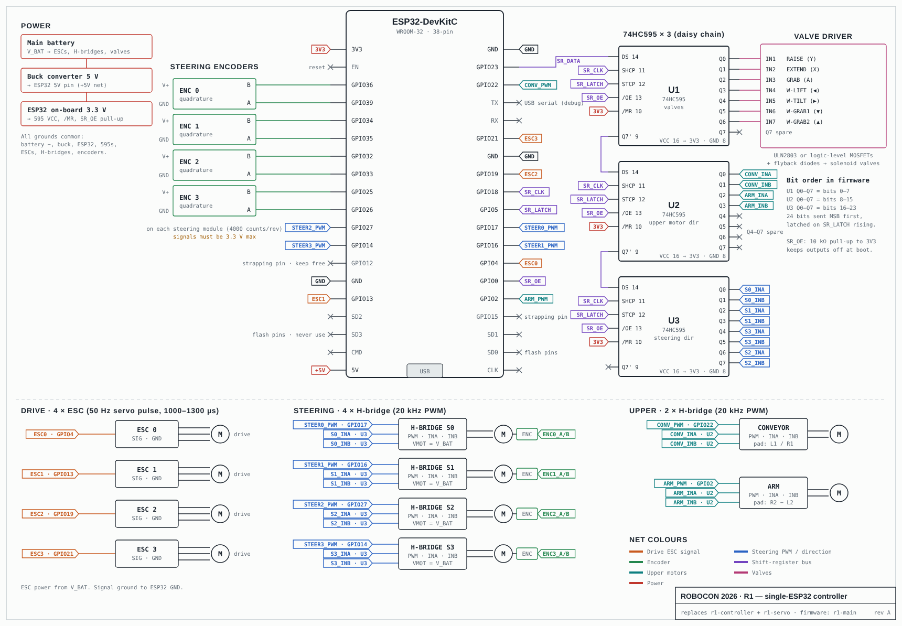

# Robocon-2027

Robocon-2027

Firmware for **R1**, our robot for **ABU Robocon 2027**. R1 is a **4-wheel swerve-drive** robot with a pneumatic gripper/lift mechanism, a conveyor and an arm, driven over Bluetooth with a game controller.

All of it runs on **one ESP32**. The robot used to have two boards (`r1-controller` and `r1-servo`, linked over I2C). They have been merged into a single sketch, `r1-main`.

> Related project: **[Tesseract](https://github.com/TariatiinEserguu/Tesseract)**, a raylib 4D hypercube viewer by the same author, used for practising 3D/4D math in C.

---

## Contents

- [Repository layout](#repository-layout)
- [Hardware](#hardware)
- [Software architecture](#software-architecture)
- [Gamepad controls](#gamepad-controls)
- [Building and flashing](#building-and-flashing)
- [Configuration and tuning](#configuration-and-tuning)
- [Bring-up and test modes](#bring-up-and-test-modes)
- [Safety notes](#safety-notes)

---

## Repository layout

```
Robocon-2027/
└── r1-main/r1-main/
    ├── r1-main.ino      # entry point: gamepad → swerve kinematics → commands
    ├── config.h         # ALL pins, channels and tuning values in one place
    ├── control.h        # 100 Hz control task: PID, ESCs, motors, valves
    ├── controller.h     # Bluepad32 gamepad connect/disconnect + timeout
    ├── encoder.h        # 4× quadrature encoders on the ESP32 PCNT hardware
    ├── pwm.h            # LEDC wrapper (works on Arduino-ESP32 2.x and 3.x)
    ├── shifter.h        # 3× 74HC595 shift-register chain (24 outputs)
    ├── WIRING.md        # full pin map + rewiring checklist
    ├── r1-wiring.svg    # schematic
    └── r1-wiring.png    # schematic (image)
```

## Hardware

| Subsystem       | Parts                                                    | Driven by                                   |
|-----------------|----------------------------------------------------------|---------------------------------------------|
| Brain           | ESP32-DevKitC **WROOM-32** (not WROVER)                  | n/a                                         |
| Drive           | 4× ESC (servo-style PWM, 1000–2000 µs, 50 Hz)            | LEDC ch 0–3                                 |
| Steering        | 4× DC motor + H-bridge, 4× quadrature encoder            | LEDC ch 6–9 (PWM) + shift register (dir)    |
| Upper mechanism | Conveyor DC motor, arm DC motor (H-bridges)              | LEDC ch 4–5 (PWM) + shift register (dir)    |
| Pneumatics      | 7 solenoid valves: RAISE, EXTEND, GRAB, W-LIFT, W-TILT, W-GRAB1, W-GRAB2 | shift register U1                 |
| I/O expansion   | 3× 74HC595 daisy chain (U1 → U2 → U3)                    | SPI (HSPI)                                  |
| Input           | Bluetooth gamepad (DualShock 4, DualSense, Xbox, etc.)   | Bluepad32                                   |

### Pin summary

| GPIO          | Function                         |
|---------------|----------------------------------|
| 4, 13, 19, 21 | ESC 0–3 signal                   |
| 17, 16, 27, 14| Steering H-bridge 0–3 PWM        |
| 39/36, 35/34, 33/32, 26/25 | Encoder 0–3 A/B     |
| 22            | Conveyor PWM                     |
| 2             | Arm PWM                          |
| 23 / 18 / 5   | 595 DATA / CLK / LATCH           |
| 0             | 595 /OE (10 kΩ pull-up to 3V3)   |

### Shift-register bit map (24 bits)

| Bits  | Chip | Function                                                      |
|-------|------|---------------------------------------------------------------|
| 0–6   | U1   | Valves: RAISE, EXTEND, GRAB, W-LIFT, W-TILT, W-GRAB1, W-GRAB2 |
| 8–11  | U2   | Conveyor INA/INB, arm INA/INB                                 |
| 16–23 | U3   | Steering INA/INB for modules 0, 1, 3, 2                       |

See **[`WIRING.md`](r1-main/r1-main/WIRING.md)** for the full table, the old-board → new-board rewiring checklist and the schematic:



## Software architecture

The work is split into two FreeRTOS tasks, both on **core 1** (Bluetooth runs on core 0):

```
 loop()  (prio 1, ~100 Hz)                         controlTask  (prio 3, 100 Hz)
 ──────────────────────────                        ──────────────────────────────
  read gamepad (Bluepad32)                          fetch latest Command
  swerve kinematics                                 read 4 encoders (PCNT)
  button → valve toggles     ── Shared::publish ──▶ steering PID → PWM + dir bits
  failsafe on timeout            (critical section) ESC pulse widths
                                                    conveyor / arm PWM + dir bits
                                                    one 24-bit shift-register write
```

- **`controlTask` is the only code that touches outputs.** Because of this there are no races on the LEDC channels or the shift register.
- Commands pass between the two tasks as one `Shared::Command` struct, copied under a spin lock.
- **Swerve kinematics:** for each wheel the code adds the translation vector (right stick) to that wheel's rotation vector (left stick X). The angle of the sum becomes the steering target and its length becomes the ESC speed.
- **Steering targets are multi-turn.** `nearestTarget()` always picks the shortest way to the new angle, so a module never spins the long way round.
- When the wheel speed is below `MIN_ACCEPTABLE_SPEED`, the module **keeps its last angle**. This stops the wheels twitching around the stick dead-zone.
- The encoders count on the hardware pulse counter, with overflow handled in an ISR. Both the legacy (IDF 4.4) and the new (IDF 5) PCNT drivers are supported.

## Gamepad controls

The buttons use Bluepad32's Xbox-style names. On a PlayStation controller **A = ✕, B = ○, X = □, Y = △**.

| Input                  | Action                                            |
|------------------------|---------------------------------------------------|
| Right stick            | Drive (translate)                                 |
| Left stick X           | Rotate in place                                   |
| **B** (hold)           | Stop drive and point all wheels straight (0°)     |
| L1 / R1                | Conveyor forward / reverse                        |
| R2 / L2 (analog)       | Arm up / down (proportional)                      |
| **A**                  | Toggle GRAB valve                                 |
| **X**                  | Toggle EXTEND valve                               |
| **Y**                  | Toggle RAISE valve                                |
| D-pad ↑                | Toggle W-GRAB2 valve                              |
| D-pad ↓                | Toggle W-GRAB1 valve                              |
| D-pad →                | Toggle W-TILT valve                               |
| D-pad ←                | Toggle W-LIFT valve                               |

**Failsafe:** if the controller disconnects or sends no data for `CONTROLLER_TIMEOUT_MS` (1 s), the drive ESCs stop, the steering returns to 0, and the conveyor and arm stop. The valves **keep their current state**.

## Building and flashing

1. Install the **Arduino IDE** (2.x).
2. Add the Bluepad32 board package. In **File → Preferences → Additional boards manager URLs**, add:
   ```
   https://raw.githubusercontent.com/ricardoquesada/esp32-arduino-lib-builder/master/bluepad32_files/package_esp32_bluepad32_index.json
   ```
   Then install **esp32_bluepad32** from the Boards Manager. If the URL above stops working, see the [Bluepad32 Arduino docs](https://bluepad32.readthedocs.io/).
3. Pick **Tools → Board → esp32_bluepad32 → ESP32 Dev Module**.
   ⚠️ There are *two* "ESP32 Dev Module" entries. The one under the plain Espressif `esp32` package will not build: the sketch stops with `#error "Wrong board..."`.
4. If you installed the **"Bluepad32" library** from the Library Manager, **uninstall it**. That one is for NINA boards, not the ESP32.
5. Open `r1-main/r1-main/r1-main.ino`, select the port and click **Upload**. No other libraries are needed.
6. Open the Serial Monitor at **115200 baud**. You should see `R1 single-controller ready.`
7. Put the gamepad in pairing mode. Only the first controller to connect is used.

> **Before power-up, point all four wheels straight ahead.** The steering encoders are relative and start at 0 on boot.

## Configuration and tuning

Every pin and constant is in **[`config.h`](r1-main/r1-main/config.h)** (namespace `Cfg`). The values you are most likely to change:

| Constant                 | Default            | Meaning                                                  |
|--------------------------|--------------------|----------------------------------------------------------|
| `STEER_P / I / D`        | 0.2 / 0 / 0        | Steering position PID gains                              |
| `CONTROL_PERIOD_MS`      | 10                 | Control loop period (100 Hz)                             |
| `STEER_MAX_DUTY`         | 100 / 255          | Steering motor duty limit                                |
| `STEER_MOTOR_DIR[]`      | {1, 1, -1, 1}      | Flip a steering motor's direction                        |
| `ENC_DIR[]`              | {-1, -1, -1, -1}   | Flip an encoder's direction                              |
| `COUNTS_PER_REV[]`       | 4000               | Encoder counts per full steering turn                    |
| `MOTOR_ORDERS[]`         | {2, 3, 1, 0}       | Logical wheel → physical module                          |
| `ROT_DIRECTIONS[][]`     | see file           | Rotation vector of each wheel                            |
| `SPEED_MULTIPLIER`       | 0.5                | Stick → drive speed scale                                |
| `ROT_MULTIPLIER`         | 0.25               | Stick → rotation scale                                   |
| `MAX_SPEED`              | 300                | Max µs above `ESC_MIN_US` (caps the ESC at 1300 µs)      |
| `MIN_ACCEPTABLE_SPEED`   | 50                 | Below this the wheel keeps its angle                     |
| `MAX_CONVEYOR_DUTY`      | 100 / 255          | Conveyor duty limit                                      |
| `MAX_ARM_DUTY`           | 50 / 255           | Arm duty limit                                           |
| `CONTROLLER_TIMEOUT_MS`  | 1000               | Gamepad failsafe timeout                                 |
| `SR_OE`                  | 0                  | 595 /OE pin; set `-1` if not wired (30-pin DevKit)       |

## Bring-up and test modes

At the top of `r1-main.ino`, uncomment **at most one** `TEST_*` define (plus `PRINT_ENCODERS` if you want it):

| Define               | What it does                                                                 |
|----------------------|------------------------------------------------------------------------------|
| `TEST_STEER_MOTORS`  | Open-loop sweep of each steering motor in turn. Use it to check wiring and `STEER_MOTOR_DIR` |
| `PRINT_ENCODERS`     | Prints the encoder counts and targets every 500 ms. Use it to check `ENC_DIR` and `COUNTS_PER_REV` |
| `TEST_ENCODER`       | Type `<motor> <count>` pairs in the Serial Monitor (e.g. `0 1000 2 -500`) to set steering targets |
| `TEST_STEER_STEP`    | All steering targets step 0 ↔ 360 counts every 2 s. Use it to tune the PID  |

Suggested order: **motors → encoders → single targets → step response → full gamepad drive.**

## Safety notes

- Use a **WROOM-32** module only. WROVER uses GPIO16/17 for PSRAM.
- ESP32 inputs are **3.3 V max**. The encoders must run at 3.3 V or go through level shifters.
- **Nothing may pull GPIO2 high at boot**, or flashing fails.
- On a 30-pin DevKit (no GPIO0 on the header), tie /OE to GND and set `SR_OE = -1`.
- Use **one common ground** for the ESP32, ESCs, H-bridges and the valve driver.
- /OE is held high until the shift register has latched all zeros, so the valves and H-bridges stay off during boot.

---

Made for PISDAAAAAAAAAAA
